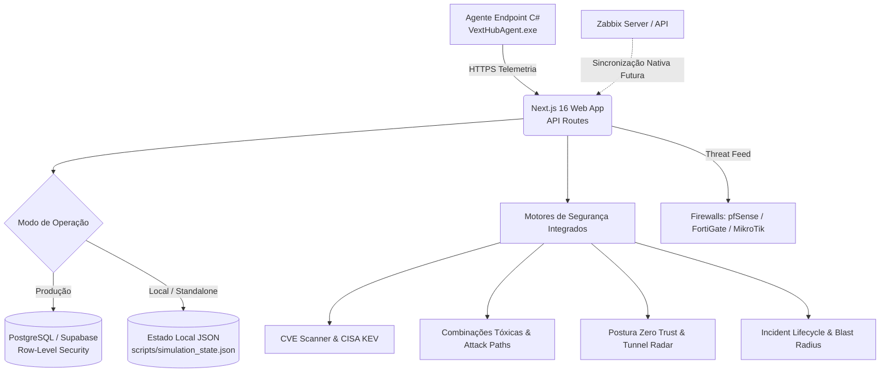

# VextHub 4.0 — Plataforma Unificada de Gestão de Endpoints & Ciberdefesa

[](https://nextjs.org/)
[](https://www.typescriptlang.org/)
[](https://docs.microsoft.com/dotnet/csharp/)
[]()
[]()
[]()

O **VextHub** é uma plataforma corporativa completa e moderna de **Gestão de Ativos, Gestão de Vulnerabilidades (TVM), Detecção e Resposta a Ameaças (TDR), Zero Trust e Conformidade GRC**. 

Projetada com a filosofia de **Custo Zero e Dependência Zero de Ferramentas Pagas**, o VextHub opera 100% *on-premises* ou em nuvem própria, sem exigir assinaturas comerciais, tokens de APIs pagas ou serviços de terceiros para suas funções centrais de auditoria e segurança.

---

## 🎯 Principais Capacidades da Plataforma

### 1. Gestão de Vulnerabilidades & CISA KEV (Estilo Wiz TVM)
- **Comparador Semântico Puro**: Analisa as versões de softwares instalados nas máquinas clientes contra faixas de vulnerabilidade sem depender de APIs externas.
- **Catálogo de CVEs Críticas**: Base curada de vulnerabilidades de alto impacto em softwares corporativos (OpenSSH, WinRAR, 7-Zip, AnyDesk, PuTTY, Chrome, Zoom, FortiClient, etc.).
- **Priorização por Exploração Ativa (CISA KEV)**: Alerta imediato sobre falhas com exploração comprovada em ambiente selvagem (*in-the-wild*).
- **Escore CVSS v3 & Remediação**: Cálculo de impacto e recomendações acionáveis para o time de suporte/TI.

### 2. Detecção de Ameaças & Combinações Tóxicas (Estilo Wiz TDR / Clavis SIEM)
- **Correlação Multi-Sinal**: Cruza vulnerabilidades, portas em escuta, processos em execução e conexões externas no mesmo host.
- **Detecção de Caminhos de Ataque**:
  - *Remote Breach Path*: CVE crítica ou RAT não autorizado + porta sensível (3389, 445, 5900, 22) + conexão externa ativa.
  - *Stealth Persistence Path*: Executáveis em `%TEMP%`/`%APPDATA%` + chave de inicialização no Registro + LOLBins codificados (PowerShell `-enc`, `regsvr32`).
  - *Lateral Movement / Exfiltration Path*: Indicadores de dump de credenciais (LSASS) + sessões SMB/RDP ativas + desvio estatístico populacional (Z-Score $\ge 2.5$).
- **Mapeamento MITRE ATT&CK**: Classificação visual por estágios de Kill-Chain.

### 3. Postura Zero Trust & Radar de Shadow IT (Estilo Cloudflare One)
- **Avaliação Contínua de Postura**: Veredito instantâneo para cada máquina da frota:
  - `TRUSTED` (Conforme e protegida)
  - `RESTRICTED` (Alerta moderado ou atualização pendente)
  - `QUARANTINED` (Comprometimento ativo ou risco crítico detectado)
- **Radar de Túneis Reversos**: Detecta utilitários de evasão e bypass de perímetro (`ngrok`, `cloudflared`, `tailscale`, `zerotier`, `chisel`, `tor`, `plink`, VPNs comerciais não autorizadas e portas C2 como 4444, 1337, 3333, 8443).
- **Feed para Firewalls Corporativos**: Rota protegida `/api/security/zerotrust-feed` que gera listas de quarentena em tempo real compatíveis com **pfSense, FortiGate, MikroTik e Linux iptables**.

### 4. Fast-Track de Incidentes, Raio de Explosão & GRC (Estilo TIVIT & Clavis GRC)
- **Ciclo de Resposta a Incidentes**: Pipeline estruturado de 4 estágios (`TRIAGE` $\rightarrow$ `CONTAINMENT` $\rightarrow$ `ERADICATION` $\rightarrow$ `RECOVERED`).
- **Controle de SLA por Severidade**: Prazos automáticos de contenção (Crítico: 1h, Alto: 4h, Médio: 24h, Baixo: 72h).
- **Cálculo de Raio de Explosão (*Blast Radius*)**: Algoritmo $O(N)$ que identifica instantaneamente todos os demais computadores da frota que compartilham a mesma versão vulnerável ou porta exposta.
- **Auditoria de Conformidade Regulatória**: Cada achado é automaticamente etiquetado com os controles:
  - **ISO/IEC 27001:2022**: A.8.8, A.8.16, A.8.15 e A.5.24.
  - **LGPD**: Art. 46 e Art. 48.
  - **CIS Controls v8**: Controles 7, 8 e 17.
- **Laudos Executivos**: Exportação em **PDF vetorial** (`jspdf`) e **CSV** (RFC-4180 com UTF-8 BOM) com métricas de SOC (MTTD e MTTR).

### 5. Agente de Endpoint C# Nativo
- Binário leve e seguro compilado em C# (.NET Framework 4.0), compatível com Windows 7, 10, 11 e Windows Server.
- Suporte a execução em **Bandeja do Sistema (Tray)** ou como **Windows Service** nativo em segundo plano (`--service`, `--install-service`, `--uninstall-service`).
- Zero dependência de runtimes pesados ou scripts desprotegidos.

---

## 🏗️ Arquitetura do Sistema



---

## 🚀 Instalação e Execução Rápida

### Pré-requisitos
- **Node.js**: Versão 20.x ou superior (LTS recomendada).
- **Git** instalado.
- *(Opcional para compilar o agente C#)*: Windows com .NET Framework 4.0+ (`csc.exe`).

### 1. Clonar o Repositório e Instalar Dependências
```powershell
git clone <URL_DO_SEU_REPOSITORIO>
cd "VEXT hub"
npm install
```

### 2. Configurar Variáveis de Ambiente
Copie o arquivo de exemplo e crie seu `.env`:
```powershell
copy .env.example .env
```
Edite o arquivo `.env` gerando um segredo forte para o agente:
```env
AGENT_SHARED_SECRET=chave_secreta_com_pelo_menos_24_caracteres_aleatorios
```

> **Dica**: No modo de desenvolvimento ou standalone, o VextHub opera perfeitamente sem Supabase configurado, usando a base simulada local.

### 3. Iniciar o Servidor de Desenvolvimento
```powershell
npm run dev
```
Abra o navegador em: **`http://localhost:3000`**

### 4. Build de Produção
Para verificar a integridade completa da aplicação:
```powershell
npm run lint    # Verificação de qualidade (0 erros / 0 avisos)
npx tsc --noEmit # Checagem estrita de tipos TypeScript
npm run build   # Compilação otimizada das 35 rotas
```

---

## 💻 Compilação do Agente C# (Windows)

O agente de endpoint fica localizado em `src/installer/`. Para compilá-lo:

```powershell
powershell -NoProfile -ExecutionPolicy Bypass -File src/installer/build_installer.ps1
```
Esse comando gera os binários `VextHubAgent.exe` e `VextHub_Agent.exe` em `public/installer/`.

### Como rodar o Agente na máquina do cliente:
1. **Modo Bandeja (Usuário)**:
   Basta executar o `VextHubAgent.exe`. Ele exibirá o ícone na bandeja do sistema e enviará o pulso de telemetria periodicamente.
2. **Modo Windows Service (Serviço do Sistema)**:
   Abra o PowerShell como Administrador e execute:
   ```powershell
   .\VextHubAgent.exe --install-service
   Start-Service VextHubAgent
   ```
   Para desinstalar:
   ```powershell
   Stop-Service VextHubAgent
   .\VextHubAgent.exe --uninstall-service
   ```

---

## 📂 Estrutura do Projeto

```text
├── docs/                             # Documentação técnica e manuais detalhados
│   ├── MANUAL_DE_USO_E_CONFIGURACAO.md # Manual completo de ponta a ponta
│   ├── ARCHITECTURE.md               # Detalhamento de arquitetura dos módulos
│   ├── AUDIT_AND_ROADMAP.md          # Relatório mestre de auditoria e evolução
│   └── SECURITY.md                   # Diretrizes defensivas e controles
├── infra/                            # Modelagem de infraestrutura e banco
│   └── supabase/vexthub_schema.sql   # Schema multi-tenant com Row-Level Security
├── public/                           # Arquivos estáticos e instaladores do agente
├── services/api/                     # Serviço backend Python FastAPI (opcional)
├── src/
│   ├── app/                          # Rotas Next.js (App Router)
│   │   ├── api/                      # Endpoints REST (telemetria, feeds, instalador)
│   │   └── dashboard/                # Painéis (Segurança, Máquinas, Conformidade, etc.)
│   ├── components/                   # Componentes React (DeviceDetails, MalwareLab, etc.)
│   ├── installer/                    # Código-fonte do Agente C# (VextHubAgent.cs)
│   └── utils/
│       ├── export/                   # Exportador executivo de relatórios PDF e CSV
│       └── security/                 # Motores centrais de segurança (CVE, ZTNA, IR, etc.)
```

---

## 📖 Documentação Detalhada

Para instruções aprofundadas sobre o uso de cada tela, configuração de firewalls e boas práticas de implantação, consulte o:
👉 **[Manual Completo de Uso e Configuração](file:///e:/Dev/Dev/VEXT%20hub/docs/MANUAL_DE_USO_E_CONFIGURACAO.md)**

---

## 🔒 Segurança e Privacidade

Este repositório foi desenvolvido para ser mantido em ambiente **privado**. Certifique-se de que nenhum arquivo `.env` ou chaves de produção sejam commitados no controle de versão. O arquivo `.gitignore` já vem pré-configurado para ignorar segredos e logs automaticamente.
